# Checking guide

Barry, 5 November 2026. This is the long form of Home > Checklist. Each section below matches a section of the
checklist, and each check has the same id (S1, HM2, P12 ...). For each: exactly what to click, and exactly what you
should see. Pictures show what a correct result looks like. Open this page in Home > Help > Build Documents
("Checking guide") beside the checklist, or in VS Code (docs/CHECKING_GUIDE.md).

Words used: the **left column** is the narrow coloured panel on the left; the **subtabs** are the second row of tabs
(Categories, Errors ...); the **caption** is the bar under the subtabs with the item's name and a **v** button at its
right, which opens the **caption menu**; the **Commands** button is at the top of the left column.

If something does not match: on Home > Checklist type what you saw in the box and press Add item, and tell me.

---

## 0. Setting up

**S1.** In a VS Code terminal in C:\Users\barry\Desktop\sketchpad type, one at a time:
`git fetch`, `git checkout claude/tier-a`, `git pull`, `npm install`.
*See:* `git checkout` says "Switched to branch 'claude/tier-a'" (or "Already on"); `npm install` ends without
"ERR!".

**S2.** Close any window running Vite or the Node service. Double-click `sketchpad.bat`.
*See:* the window does **not** print "Starting Sketchpad Maintenance..." any more (that step was removed). The browser
opens Sketchpad.

**S3.** *See:* the Home tab, with **no red bar** across the top of the page area.

**S4.** Utilities tab > subtab **Tools** > category frame **Thumbnails** > **Regenerate thumbnails**. In the side panel
choose **All** and press **Regenerate**. Wait (gallery pictures take about 90 seconds).
*See:* "Made ... pictures. Skipped 5. Failed 1." (the 5 are animated scripts; the 1 is voronoi, which has never loaded).
Thumbnails were already made and committed on 5 November, so this only confirms the tool still works.

---

## 1. Every tab still works

**A1.** Click Home, Draw, Patterns, Figures, Gallery, Utilities, then the same six again.
*See:* each tab shows its usual first view both times; no red bar.

**A2.** Draw > Categories > click **Cycloid**. Move its Radius slider. Click Utilities, then Draw.
*See:* the Cycloid subtab is still open, with the Radius where you left it.

**A3.** Patterns > Categories > click any pattern. Click Gallery, then Patterns.
*See:* the same pattern is showing.

**A4.** On each tab press the **Commands** button (top of the left column).
*See:* a side panel slides in from the right titled "... Maintenance"; its X closes it.

**A5.** On any tab press the caption menu **v** > **Help**.
*See:* the Help browser; its tree now also has folders **BuildDocs** and **Reflections**, and no title starts with
"Help Treatise".

---

## 2. Home

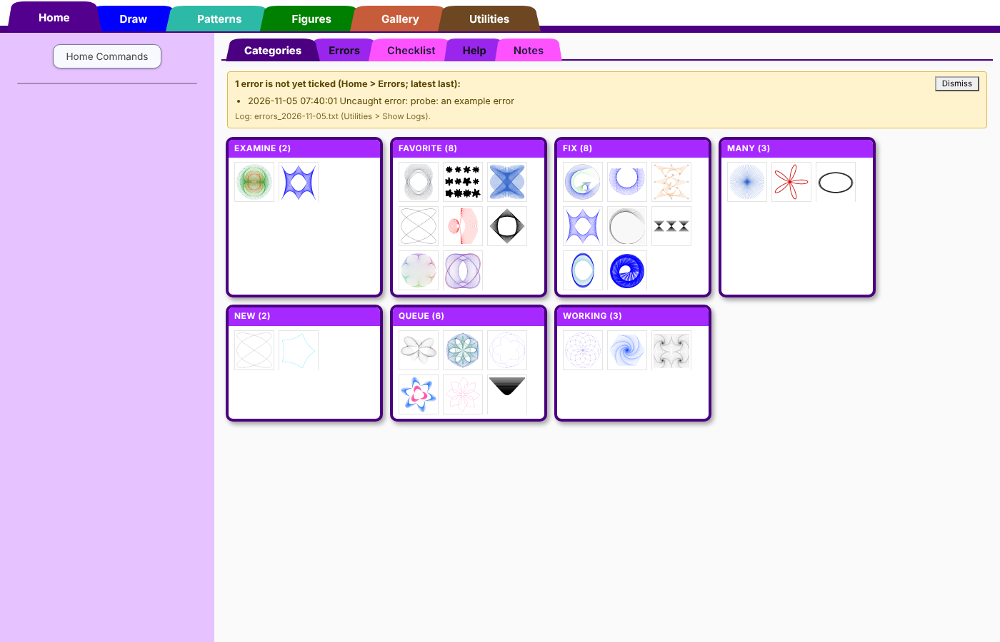

**HM1.** Click Home. *See:* subtabs **Categories, Errors, Checklist, Help, Notes** (as in the picture). A **Results**
subtab appears only after you open an item.

**HM2.** Categories. *See:* one frame per status, such as Queue, fix, Examine, favorite, working. Ideabook pictures are
no longer there (their status codes were removed on 5 November, as you asked).

**HM3.** Click a script in a frame. *See:* the Results subtab opens and the script draws on the canvas; Prev and Next in
the caption step to the other items with the same status.

**HM4.** Click a picture item (if a frame has one). *See:* it shows in Results.

**HM5.** If a frame holds a Draw object, click it. *See:* the Draw tab opens on that object.

**HM6.** *See:* the yellow alert bar at the top of Home appears only when an error has not been ticked, or when the
last manifest check found problems. Its **Dismiss** hides it.

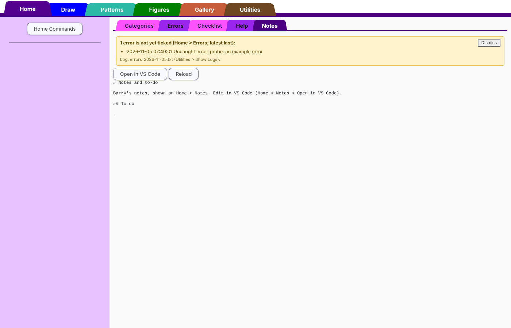

**T4.** Home > **Notes**. *See:* the text of home/notes.md under two buttons. Press **Open in VS Code**: the file opens
in VS Code. Add a line, save, press **Reload**: your line shows.

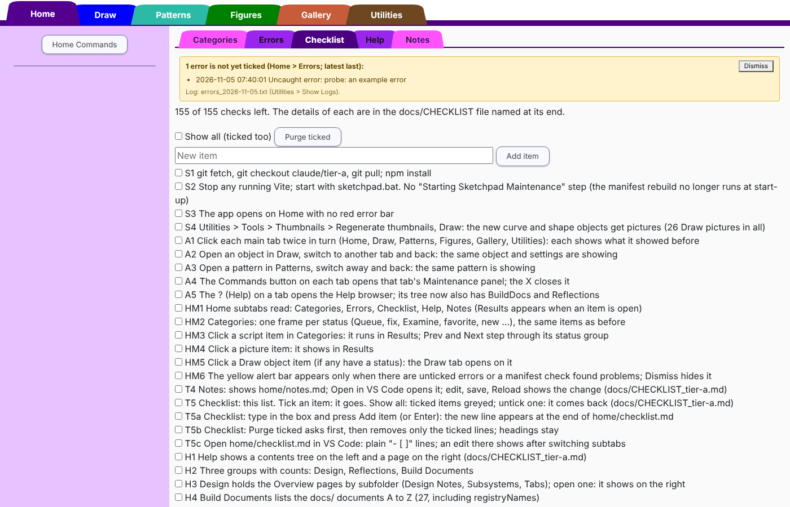

**T5.** Home > **Checklist** (this list). Tick any item. *See:* it disappears. Tick **Show all (ticked too)**: it is
back, greyed. Untick it: it is an ordinary item again.

**T5a.** Type "test item" in the box and press **Add item**. *See:* "test item" appears at the end of the list.

**T5b.** Tick "test item", press **Purge ticked**, then OK. *See:* "test item" is gone for good; headings stay.

**T5c.** Open home/checklist.md in VS Code. *See:* plain lines starting "- [ ]" (or "- [x]" when ticked). Change one
line, save, click another Home subtab and back to Checklist: your change shows.

---

## 3. Home > Help

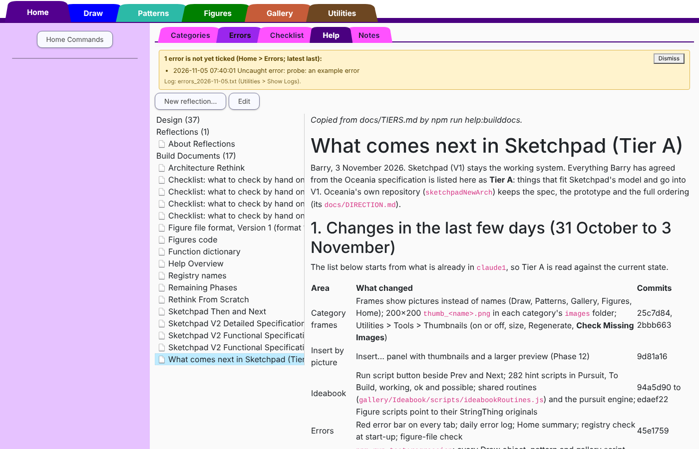

**H1.** Home > **Help**. *See:* buttons **New reflection...** and **Edit**, a contents tree on the left and a page area
on the right (as in the picture).

**H2.** *See:* three groups: **Design (n)**, **Reflections (n)**, **Build Documents (n)**.

**H3.** Open Design. *See:* folders Design Notes, Subsystems, Tabs; open one and click a page: it shows on the right.
No title starts with "Help Treatise".

**H4.** Open Build Documents. *See:* the current docs, A to Z: the checklists, Checking guide, FIGURE_FORMAT_V1,
FUNCTIONS, registryNames, TIERS and the PDFs. The superseded ones (now in docs/old) are not listed.

**H5.** Click **Tier A** (TIERS). *See:* real headings, tables with lines, and lists, not raw Markdown with # and |.

**H6.** Click a PDF entry, such as Sketchpad V2 Functional Specification RevB. *See:* the PDF inside the page; the link
**Open the PDF on its own** opens it in a browser tab.

**H7.** Press **New reflection...**, type "My first reflection", OK. *See:* the help editor opens on a page headed
"My first reflection".

**H8.** Type a sentence in the editor, press **Save**, then close the overlay (its X). *See:* under Reflections,
"My first reflection" is listed; click it: your sentence shows.

**H9.** With it chosen, press **Edit**. *See:* the editor with your sentence; change it, Save: the change shows.

**H10.** Click a Design page. *See:* **Edit** is greyed. Same for a Build Documents page.

**H11.** Press **New reflection...** and type "My first reflection" again. *See:* a message that the file is already
used; nothing is overwritten.

**H12.** Edit any docs/*.md file (add a word), save, then in a terminal run `npm run help:builddocs`. Back in Help,
click that document. *See:* your word.

**H13.** Build Documents > **Registry names**. *See:* a table of the twelve new objects; polygon, ellipse and
archimedeanSpiral are marked ambiguous, each with the reason.

---

## 4. Errors

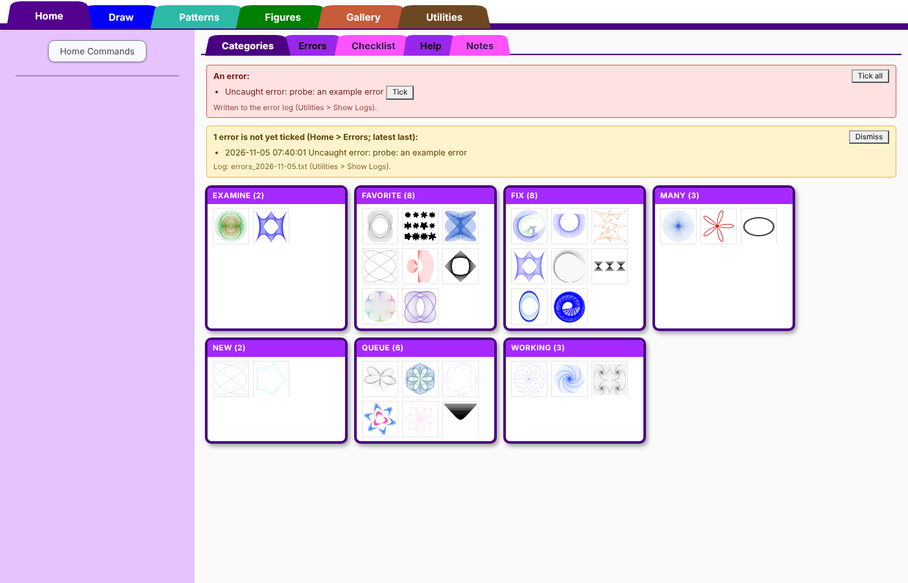

**E1 to E6.** As in docs/CHECKLIST_v1-errors.md (E5 now also lists the twelve new objects as OK).

**T3.** Press F12 to open the browser console, type
`setTimeout(() => { throw new Error("probe") }, 0)` and press Enter.
*See:* the red bar, as in the picture: "Uncaught error: probe" with a **Tick** button, and **Tick all** at the right.

**T3a.** Press **Tick**. *See:* the red bar goes. Open utilities/logfiles/errors_<today>.txt in VS Code: a line
"Acknowledged: Uncaught error: probe".

**T3b.** Make the same error again (repeat T3), then reload the page (F5). *See:* Home's yellow bar says
"1 error is not yet ticked".

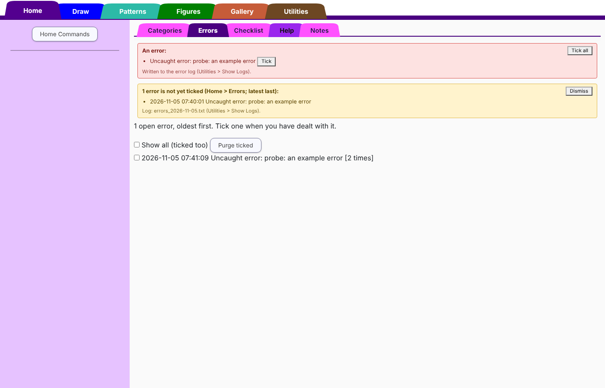

**T3c.** Home > **Errors**. *See:* the error with a checkbox (as in the picture). Tick it: it disappears.

**T3d.** Tick **Show all**: it is back, greyed and ticked. Press **Purge ticked**, OK. *See:* it is gone even with Show
all. The log file still has every line, plus "Purged: Uncaught error: probe".

---

## 5. Lists from the folders

Since 4 November every list is worked out from the files in the folders. manifest.json files only add titles,
statuses and order.

**L1.** Look through Patterns, Gallery (Ideabook, Patterns, Scripts), Utilities (Tools, Lab) and Figures.
*See:* the same categories and items as before.

**L1a.** Draw > Categories. *See:* two new frames, **curves** (9 items) and **shapes** (3), beside the old ones; objects
that have saved settings are marked as before, and no others.

**L2.** Home > Categories. *See:* the same items as before, apart from Ideabook pictures.

**L3.** In VS Code copy patterns/circles/circle.js to patterns/circles/circleCopy.js (do not touch manifest.json).
Reload the page, Patterns > circles. *See:* "circleCopy.js" in the list.

**L4.** Delete circleCopy.js and reload. *See:* it is gone; the rest of circles is fine; no red bar.

**L4a.** Copy any picture into gallery/Ideabook/ok (manifest untouched); reload; Gallery > Ideabook > ok. *See:* the
picture is in the list. Delete it afterwards.

**L5.** Patterns, open a pattern, caption menu > **Edit Manifest**: change its title; Save. *See:* the new title in the
list. Set a status (for example Queue): Home > Categories shows it under Queue.

**L6.** Figures: make a figure and **Save As** into a new category. *See:* Figures > Categories lists it.

**L7.** Archive a test item (caption menu > Archive). *See:* it leaves its list; its file is in the archive folder.

**L8.** Home > Commands > **Rebuild & Validate**. *See:* a report, as before.

**L9.** Gallery > Ideabook > a category: step with Next. *See:* the same order as before.

---

## 6. Draw

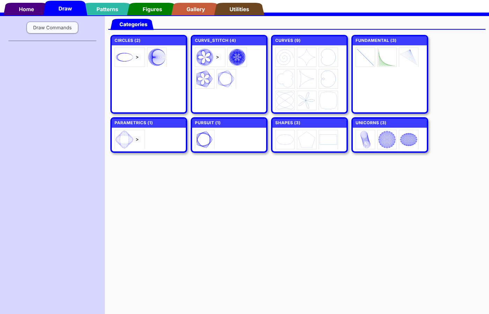

**D1.** Draw > Categories: open each object in turn. *See:* each draws something.

**D2.** Drag a red handle. *See:* the drawing follows. Click a handle and press the arrow keys: it moves 1 pixel each
press, 10 with Shift held.

**D3.** Move a slider, pick a colour, change a list (such as Stitch on a curve). *See:* the drawing changes at once.

**D4.** Caption menu: **Save as PNG**, **Save as Pattern**, **Copy Object**, **Reset Parameters**. *See:* each works
as before.

**D5.** An object marked as having saved settings: open them from its frame; change one; save. *See:* as before.

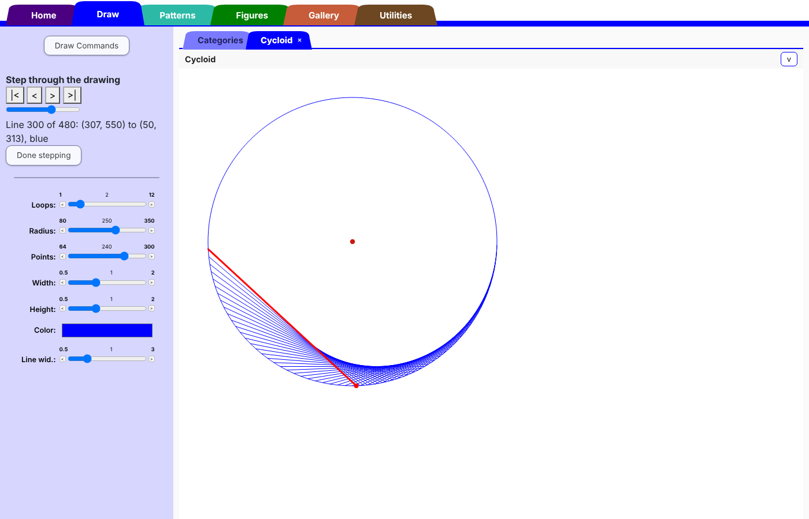

**T2.** Draw > Cycloid > caption menu **v** > **Step through the drawing**. *See:* in the left column (as in the
picture) the title "Step through the drawing", buttons `|<  <  >  >|`, a slider, the line "Line N of N: (x, y) to
(x, y), blue", and **Done stepping**.

**T2a.** Press `|<`. *See:* one short line only, drawn thick and red, with a red dot at its start; "Line 1 of ...".
Press `>`: line 2 is added. Drag the slider: the drawing grows or shrinks; the readout always describes the red line.

**T2b.** While stepping, move the Radius slider. *See:* the drawing changes size and stepping carries on.

**T2c.** Press **Done stepping**. *See:* the whole drawing again and the stepping controls gone. Start stepping again,
click another tab and come back: stepping has ended.

**F9.** Sweep a setting: as in docs/CHECKLIST_v1-finish.md.

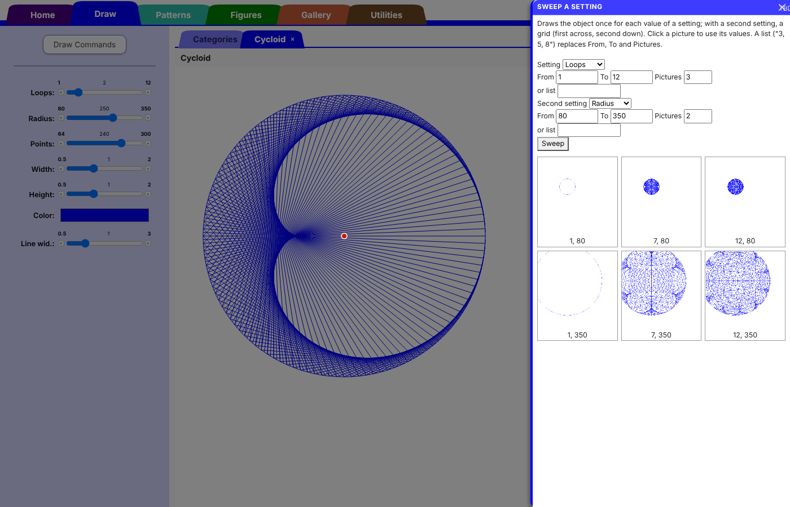

**T7.** Draw > Cycloid > caption menu > **Sweep a setting...**. Choose a **Second setting**, set its Pictures to 2,
press **Sweep**. *See:* a grid (as in the picture): the first setting changes across, the second down; each picture is
labelled with both values. Click one: both sliders take its values.

**T7a.** Type `3, 5, 8` in the first **or list** box and Sweep. *See:* exactly three columns, for 3, 5 and 8.

---

## 7. Curve library and shape palette

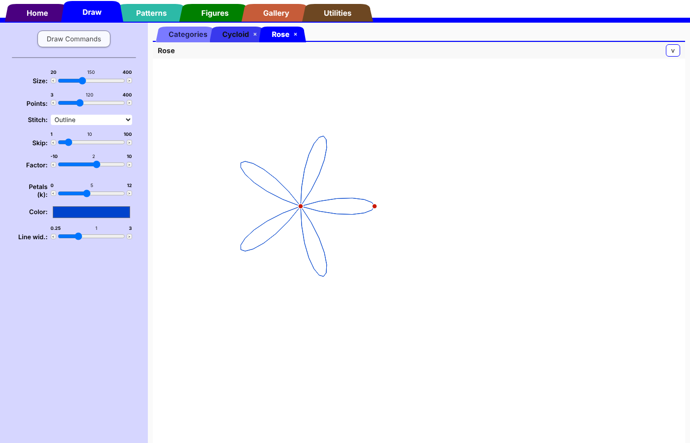

**P1.** Draw > Categories. *See:* frame **curves** with Archimedean Spiral, Astroid, Cardioid, Epicycloid,
Hypocycloid, Limacon, Lissajous, Rose, Superellipse; frame **shapes** with Ellipse, Polygon, Rectangle.

**P2.** Open **Rose**. *See:* (as in the picture) the rose, two red handles (centre and, to the right, size), and the
controls Size, Points, Stitch, Skip, Factor, Petals (k), Color, Line wid. Petals 5: five petals; 4: eight petals.

**P3.** **Lissajous**: change a, b and Phase. *See:* a 3, b 2 a pretzel shape; other values other figures.

**P4.** **Epicycloid**: Lobes 3 gives three bumps outward; more lobes, more bumps.

**P5.** **Hypocycloid**: Cusps 3 a curved triangle (deltoid), 4 a four-pointed star, more a star with more points.

**P6.** **Astroid** (a four-pointed star) and **Cardioid** (a heart, its dent at the centre) draw.

**P7.** **Limacon**: Loop 0.5 an oval, 1 a heart, 2 a loop inside a loop.

**P8.** **Superellipse**: Power 2 a circle, 4 a rounded square, 1 a diamond, 0.5 a star with curved sides.

**P9.** **Archimedean Spiral**: Turns changes the number of turns; the curve's end is not joined back to its start.

**P10.** **Rectangle** (Height / width), **Polygon** (Sides), **Ellipse** (Height / width) each change shape.

**P11.** On any of them, drag the **centre** handle. *See:* the whole object moves.

**P12.** Drag the **size** handle (the one to the right). *See:* the object grows or shrinks, and the Size slider
moves to match.

**P13.** Move the **Size** slider. *See:* the size handle moves with it.

**P14.** Move **Points** from 3 to 400. *See:* few points (a coarse outline) to many (a smooth one).

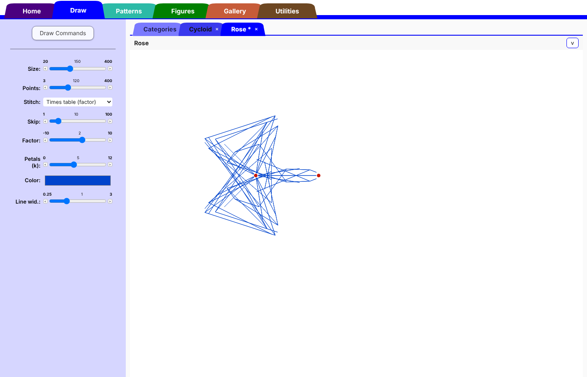

**P15.** Change **Stitch**: Outline joins each point to the next; Chords joins each to the point Skip further on (move
Skip); Times table joins point i to point i x Factor (as in the picture; try negative and fractional Factors); All
pairs joins every pair (slow above about 150 points).

**P16.** Try odd settings: Rose Petals 0, Superellipse Power 0.2, Polygon with Points 3. *See:* something odd is drawn,
not nothing, and no red bar.

**P17.** Turn on Final mode (as you normally do). *See:* only the points of the curve.

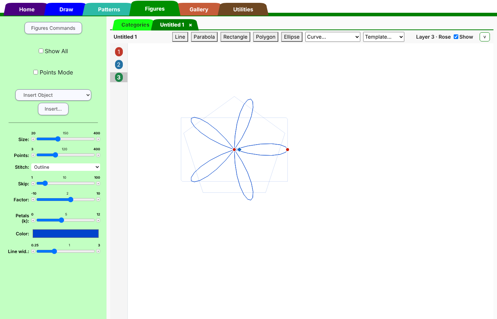

**P18.** Figures > Categories > **Create Figure**. *See:* in the caption, buttons Line, Parabola, **Rectangle,
Polygon, Ellipse**, a **Curve...** list and Template... (as in the picture).

**P19.** Press Rectangle, Polygon, Ellipse, then choose Rose in Curve.... *See:* four layers in the number strip, each
drawn.

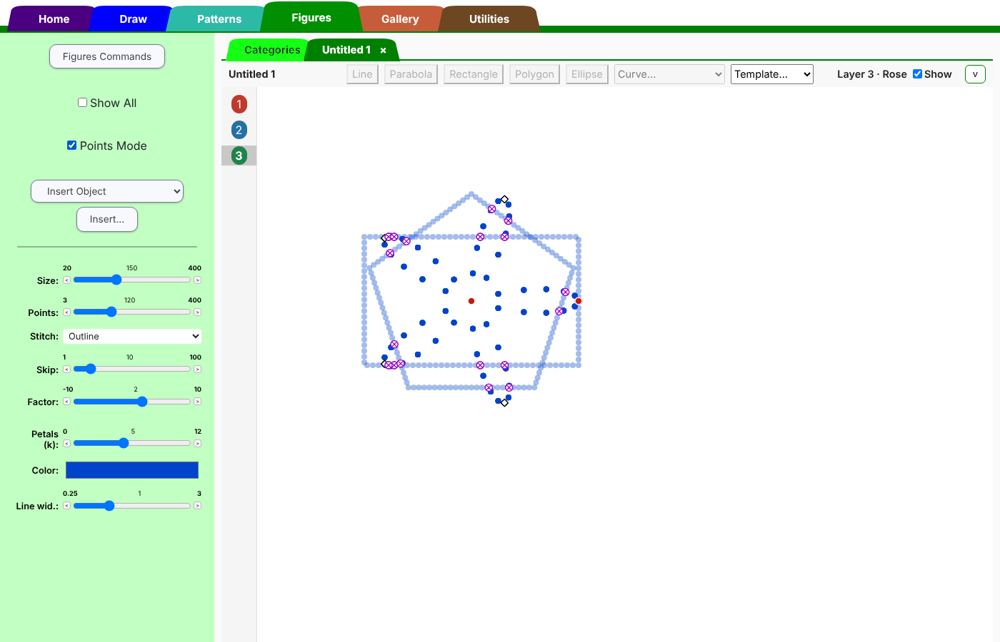

**P20.** Tick **Points Mode**. *See:* the layers' points (as in the picture); purple marks where shapes cross. Click on
one of the active curve's points: a disc appears there. Untick Points Mode, drag the curve's centre or size handle:
the disc moves with the curve.

**P21.** Put a disc on the rose and one on the polygon, then weld them as usual. *See:* the weld mark.

**P22.** With Points Mode ticked, *see:* Line, Parabola, Rectangle, Polygon, Ellipse and Curve... are greyed.

**P23.** Caption menu > **Print size...** (inches, P23 uses 8), then **Print template...**. *See:* nails at the curve
points on the sheets.

**P24.** **Save As**, close the figure, open it again. *See:* the same curves with the same settings.

**P25.** Draw > Rose > caption menu > **Save as Pattern**. *See:* the new pattern runs in Patterns.

**P26.** Read draw/curves.js, draw/ringObject.js and drawRegistry/rose.js. Can you follow them? Note anything unclear.

---

## 8. Figures

**F1, F2, F4, F5, F6, F7, F8, F10, F11.** As in docs/CHECKLIST_v1-finish.md.

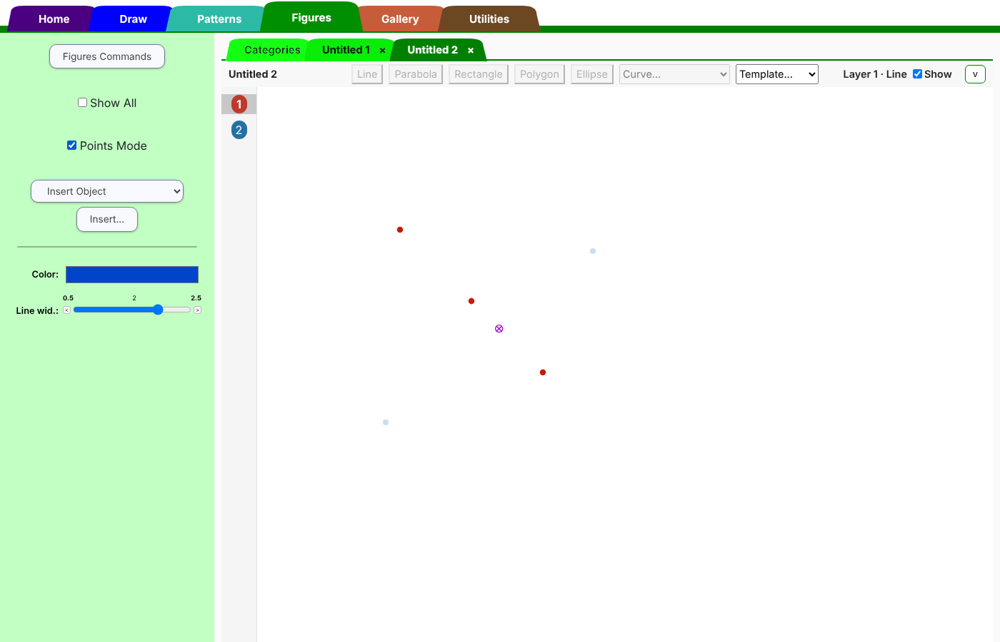

**T11.** New figure; press Line twice; drag the second line so it crosses the first; tick Points Mode. *See:* where
they cross, a **purple ring with a cross** (as in the picture); the middles of lines are black open diamonds. Click the
purple mark: a disc lands exactly there.

**T6.** Figure with discs, caption menu > **Print size...**. *See:* the question asks in **inches**. Type 8.
*See:* the menu now shows the scale in inches per 100 px.

**T6a.** Caption menu > **Nail size...** on a new figure. *See:* it asks in inches and offers "0.079, 0.187" (2 mm
nails, 3/16 inch clearance).

**T6b.** Caption menu > **Print units: inches (switch)**, then Nail size... again. *See:* it now asks in millimetres.
Switch back.

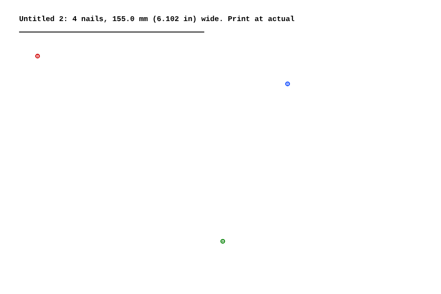

**T6c.** Caption menu > **Save template as one SVG...**, answer **OK** to colours. Open the downloaded file in a browser.
*See:* (as in the picture) the name and a line at the top, then the nails, coloured red, green, orange, blue, yellow in
turn. Save again answering **Cancel**: black nails.

**T6d.** Print the SVG from the browser at **Actual size** (100%). Measure the line at the top. *See:* exactly 100 mm.

**T6e.** **Print template...**. *See:* the cover sheet now gives nail sizes in mm and inches; the sheets as before.

**T6f.** Caption menu > **Show nail spacing problems** on a figure with close nails. *See:* red rings; then Print
template still works.

**T12.** Figure with three layers. Click layer 1 in the number strip. *See:* layer 1 is drawn over the others. Click
layer 2: layer 2 is now on top and layer 1 goes back under.

**T12a.** Click layer 1, caption menu > **Keep this layer on top**, then click layer 2. *See:* layer 2 on top while
chosen, and layer 1 above layer 3.

**T12b.** Save As, close, reopen. *See:* the kept order; clicks alone did not change the saved file.

**FG1.** Drag a handle onto another layer's handle. *See:* they snap and weld; moving one moves the other. Move one so
the welded discs no longer meet: the weld mark turns red.

**FG2.** Caption menu: **Delete layer**, **Copy**, **Reset**, **Archive** still work as before.

**FG3.** Drag a layer's centroid: it moves; select the centroid and drag the bounding box handle: it rotates.

---

## 9. Patterns, Gallery and Utilities

**F3, E7, I1 to I4, F12.** As in docs/CHECKLIST_v1-finish.md, docs/CHECKLIST_v1-errors.md and
docs/CHECKLIST_ideabook-scripts.md.

**G1.** *See:* pictures in the category frames of Patterns, Gallery, Draw and Figures. Utilities > Tools > Thumbnails:
untick **Thumbnails on**: names instead of pictures; tick it again. Move **Thumbnail size**: the pictures resize.

**G2.** Utilities > Tools > Thumbnails > **Check Missing Images**. *See:* only the scripts that cannot have a picture
(the animated ones and voronoi).

---

## 10. Codespace (the iPad)

**C1.** On the iPad, in Safari: github.com > onbostonharbor1/sketchpad > branch **claude/tier-a** > green **Code**
button > **Codespaces** > **Create codespace on claude/tier-a**. *See:* a browser VS Code; a terminal runs npm install,
then npm run dev:all.

**C1a.** In VS Code's **Ports** panel, open port **5173** (the globe icon). *See:* Sketchpad in a new tab (an address
ending in -5173.app.github.dev).

**C1b.** Draw: open an object. Figures: make a figure and **Save As**. *See:* both work (Save needs the Node service).

**C1c.** *See:* the same lists as on the PC; Home > Help opens.

**C1d.** In the Codespace's VS Code: commit and push anything you made there; then at github.com/codespaces stop the
Codespace.

**C2.** Back on the PC: Save a figure; Utilities > Show Logs; Regenerate thumbnails for Draw. *See:* all work, with no
"The Node service did not answer" while the Node service window is open.

---

## 11. Tests to run on the PC

In a VS Code terminal, with sketchpad.bat running. Each should end with PASS, or "0 failed", or "tests passed".

**R1** `npm run test:tabs` (about 8 minutes). **R2** `npm run test:regression`. **R3** `npm run test:errors`.
**R4** `npm run test:node`. **R5** `npm run test:history`. **R6** `npm run test:ideabook`.
**R7** `npm run test:shapers` (27 tests) and `npm run test:controls` (6 tests). **R8** `npm run lint:globals`: "0 errors".

If a browser test fails oddly after you edited code, close and restart Vite first (see Help > Design > Subsystems >
Tests and checks).

**T8.** After a deliberate drawing change, run R2 and open http://localhost:5173/tests/regression/report.html.
*See:* for each change: approved, now, an overlay (blue old, red new, black where both), a flicker picture (click to
start and stop) and a difference picture (changed pixels in red).

---

## 12. Reading

**O1.** Help > Design > Tabs (Home, Draw, Figures) and Subsystems (The Manifest System, nodeLayer, Parameter Controls):
the section "Changes, 3 to 5 November 2026" at the top of each.

**O2.** Help > Design > Subsystems: the eight new pages: Lists from the folders, Errors and checklists, Stepping through
a drawing, Shapers and connectors, Home Help, Running in a Codespace, Tests and checks, Curve library and shape
palette.

**T1, T10, K1, K2, K3, T9.** Read the files named on the checklist line; note anything unclear with Add item.

## 13. Decisions still yours

**Q1 to Q6.** Not checks: answer them when you are ready (tell me in chat).

---

## 14. Added 6 November: stepping in Figures, intersections, time limit

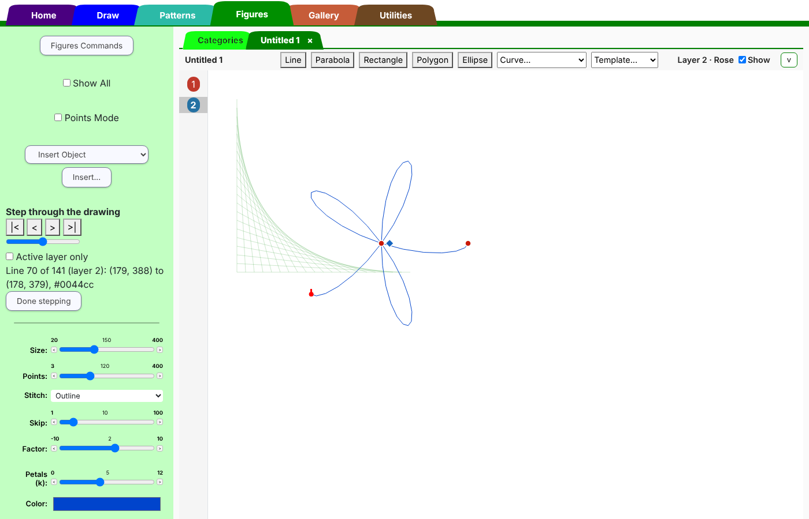

**N1.** Figures > Categories > Create Figure. Press **Parabola**, then choose **Rose** in Curve.... Caption menu **v** >
**Step through the drawing**. *See:* (as in the picture) in the left column: `|<  <  >  >|`, a slider, a checkbox
**Active layer only**, and the readout "Line N of N (layer 2): ...".

**N2.** Press `|<`. *See:* only line 1, red, of layer 1 (the parabola, drawn first because it is the bottom layer);
"(layer 1)" in the readout. Drag the slider to the right: the parabola fills in, then the rose (layer 2) starts.

**N3.** Tick **Active layer only**. *See:* the parabola is drawn in full; only the rose (the active layer) is stepped; the
count drops to the rose's lines.

**N4.** Press **Done stepping**: everything is drawn and the controls go. Start again, click another tab and back:
stepping has ended.

**N5.** Draw > Parametrics (or the Parametrics layer in a figure): tick **Show intersections**. *See:* red dots where the
curve crosses itself, in the same places as before 6 November.

**N6.** With Show intersections on, move the sliders that add points or loops to their highest. *See:* the drawing and its
dots appear within about a second; the page does not freeze.

**N7.** Figures: two crossing lines, or a rose over a polygon; tick **Points Mode**. *See:* purple rings with a cross at the
crossings, as in section 8 (T11).

**N8.** Terminal: `npm run test:intersections`. *See:* "20,000 points: ... crossings in ... ms" (tens of milliseconds) and
"11 intersection tests passed."

**N9.** Draw > Rose: Points 400, Stitch **All pairs**. *See:* a dense drawing in well under 2 seconds; no red bar.

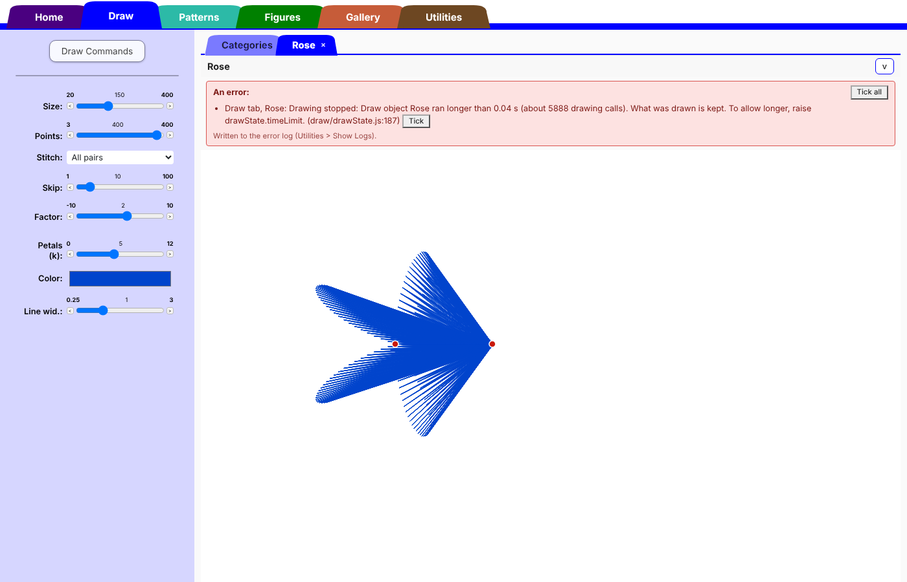

**N10.** Press F12 for the console and paste, then press Enter:

`(async () => { const s = await import("/draw/drawState.js"); const u = await import("/draw/drawUtilities.js"); s.startClock("my endless test"); try { for (;;) u.drawLine({x:0,y:0},{x:Math.random()*500,y:300}); } catch (e) { console.log(e.message); } finally { s.stopClock(); } })()`

*See:* within about 2 seconds the console prints "Drawing stopped: my endless test ran longer than 2 s ...", and the page
still responds. (In normal use the same message appears in the red bar, as in the picture, which was made with a very short
limit.)

**N11.** Run a handful of patterns and gallery scripts you know, including slow ones. *See:* each draws as before; no
"Drawing stopped" message.

**N12.** Help > Design > Subsystems: read **Intersections: a fast, tunable search**, **The time limit on drawings**, and the
section "In Figures" of **Stepping through a drawing**.

---

## 15. Added 6 November: tutorials and the help PDF

**U1.** Home > Help. *See:* a fourth group, **Tutorials (22)**, listed 01 The big picture to 22 Working practices.

**U2.** Open any tutorial. *See:* a short introduction and a list of its sections, then each section with four parts: **Read**
(files and functions), **What happens**, **Watch it** (a breakpoint or a console line) and **Try** (an exercise).

**U3.** Do one tutorial's Watch it and Try steps for real. If a function it names is not where it says, or something behaves
differently, Add item on the checklist saying which section.

**U4.** With sketchpad.bat running, in a terminal: `npm run help:pdf -- C:\Users\barry\Desktop\Sketchpad-Help.pdf`.
*See:* "Wrote ... (61 pages of help in 4 parts)". The PDF has a cover, a contents list with links, and four parts: Design:
Tabs, Design: Subsystems, Design: Design Notes, Tutorials; about 180 printed pages with page numbers.

## 16. Added 6 November: combinations

CB1 to CB4. A combination (gallery/Scripts/Combinations/) draws two existing gallery scripts as one drawing, with one set
of controls showing at a time (Controls for) and the first script's handles. The scripts are imported unchanged. The
analyzer (checkCombinable in combine.js) is run by npm run test:combinable, which writes combinable.md. Help: Overview >
Subsystems > Combinations.
